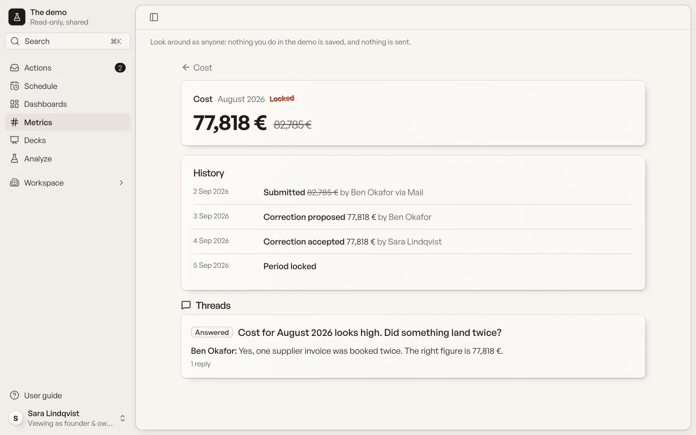
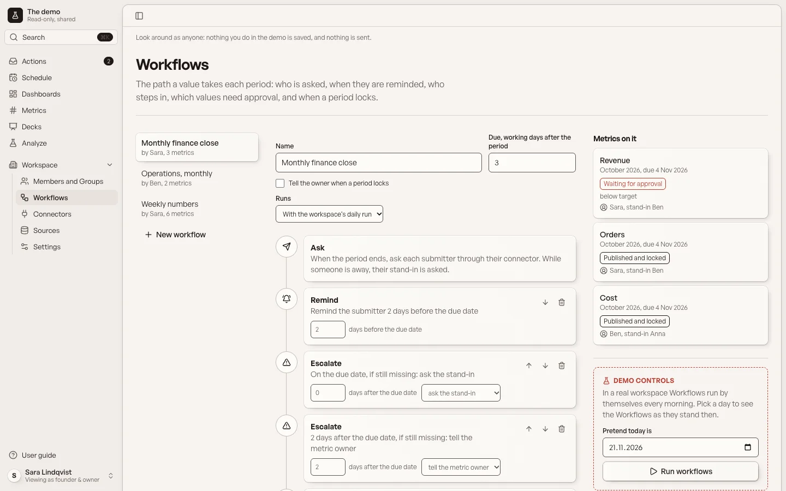
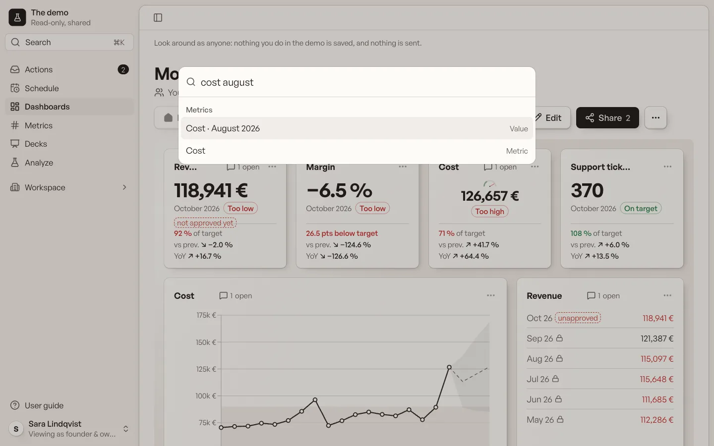
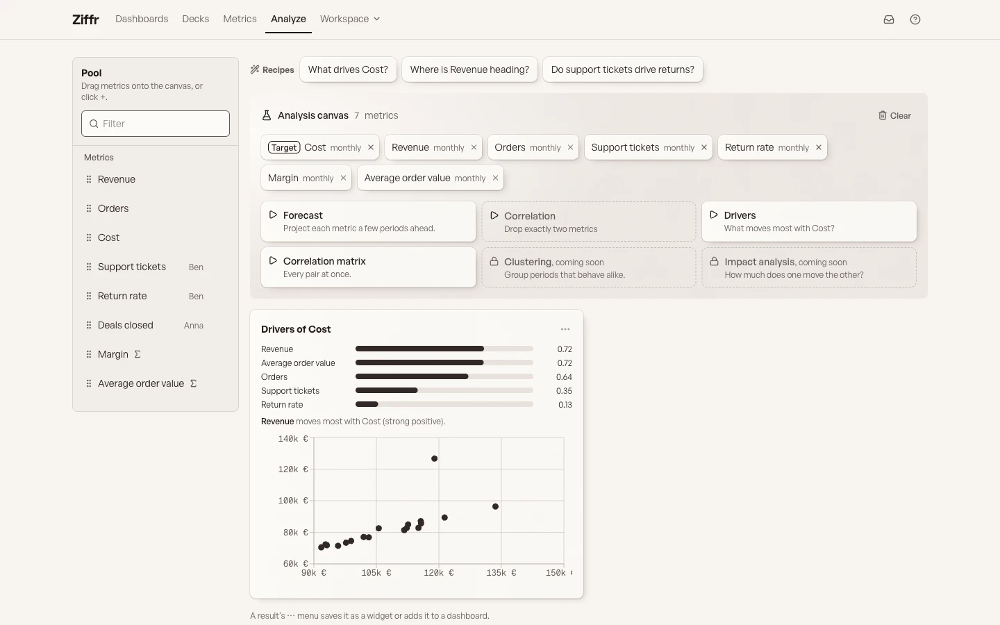

# Ziffr

[](https://github.com/ziffr/ziffr/releases/latest)
[](LICENSE)
[](https://github.com/ziffr/ziffr/labels/good%20first%20issue)

**Ziffr keeps the record of your numbers.** Paperless keeps your documents; Ziffr keeps your numbers. Define the numbers you care about. Ziffr asks people for them when they are due, or people and systems send them in on their own. Every value is kept with its history, where it came from and what people said about it, so a person or an AI assistant can look up any number from any month, without a data warehouse or a BI system. For one person, a team or a business.

- **Ask once, keep it.** A Workflow asks the right people each period, reminds whoever forgets, has unusual values approved and locks the period. People answer where they already are: a form link, an email reply, Slack or Telegram. No account needed.
- **Look it up, also for agents.** Search for "cost august" and get the value, how it came to be and the discussion about it. An AI assistant reads the same numbers through the MCP server, with the rights of its person, instead of running a live query on every question.
- **Yours to run.** Two commands start it with Docker. Source-available, with every version turning AGPL after three years.

Ziffr is in its `0.x` releases: used and tested, but names and settings may still change between versions. See the [releases](https://github.com/ziffr/ziffr/releases) for what each version brought, and the [Preview](https://github.com/ziffr/ziffr/releases/tag/preview) for what is coming in the next one.


## What it does

- **Collecting.** Define Metrics from scratch or from the Metric Catalog, with targets, Polarity and a Submission Rule. Values come in through each Submitter's personal form link, by email replies, by replying in [Telegram](docs/guides/telegram.md) or Slack, in a sentence such as "KW 46: 2" (in six languages), from a pasted or dropped spreadsheet, through the [API](docs/guides/api.md), from another system such as a CRM or a data warehouse through a [Feed](docs/guides/feeds.md), or from an AI assistant, such as Claude.ai, through the [MCP server](docs/guides/mcp.md). Contacts without an account submit too.
- **Workflows.** Ask Submitters when a period closes, remind before the Due Date, ask a Stand-in or tell the owner when a value is late, have Unusual Values approved, and lock the period. They run on their own each morning in the workspace's time zone ([scheduled jobs](docs/guides/jobs.md)).
- **The record.** Every value keeps who sent it, when, through which Source and what happened to it: replaced, Correction proposed and accepted, approved, locked. Questions and tasks on a value are answered in a Thread or by replying to the email. Search (⌘K) finds a value by words such as "churn march 2026". By default nothing is ever deleted; a Retention per Metric can condense or delete old values, only when you turn it on.
- **Seeing the numbers.** Drag-and-drop dashboards of Widgets and Findings, read as a grid or top to bottom, Snapshots that fix a dashboard to one period, an Analysis Canvas (forecast, correlation, drivers), comparisons against earlier periods and targets, and decks exported to PowerPoint or PDF.
- **Telling you.** Alerts tell a person when a value reaches a share of its target, crosses a number, changes more than expected or is not in on time. Signed Webhooks and ready-made n8n templates carry questions and tasks to other tools.
- **Your own Views and Analyses, without code.** [View Designs](docs/guides/view-designs.md) and [Analysis Recipes](docs/guides/analysis-recipes.md) are plain files Ziffr checks and draws with its own renderer and verified functions. [Packs](docs/guides/packs.md) bundle Metrics, dashboards, Workflows and more for others to install.
- **Teams.** Workspaces with Owners, Admins, Members and Guests; sharing with people and Groups; invitations by email or link; handover when someone leaves; View Links for people outside; an Audit Log of who changed who sees what.
- **For programs and assistants.** A versioned REST API with Access Keys, limits and an Access Log, a TypeScript SDK ([`@ziffr/sdk`](https://www.npmjs.com/package/@ziffr/sdk)) and an MCP server ([`@ziffr/mcp`](https://www.npmjs.com/package/@ziffr/mcp), or `/mcp` on your own Ziffr for Claude.ai). Feeds send values from your own systems with [`@ziffr/feed-kit`](https://www.npmjs.com/package/@ziffr/feed-kit) and [`@ziffr/feed-sql`](https://www.npmjs.com/package/@ziffr/feed-sql).

| | |
| --- | --- |
|  |  |
| **The record of one value**: who sent it, the Correction, the lock and the Thread | **A Workflow** that asks for each value, reminds, checks and has it approved |
|  |  |
| **Search** finds a value by words, such as "cost august" | **The Analysis Canvas**: forecast, correlation and drivers |

The screenshots show the demo's made-up online shop.

## Try it

**The demo.** Try it at **[demo.ziffr.net](https://demo.ziffr.net)**, nothing to install. "Try the demo" opens a made-up 15-person online shop, without an account; everyone shares it, and it starts fresh every night. "Try it for real" on the same page makes a trial Workspace of your own for 14 days, where requests for values reach you by email. Its data is generated relative to today, so last month's cost spike stays last month. Switch between its people with "View as" and reset it with ↺ in the header. The guided tour (bottom right) walks through defining a Metric, capturing a value, building a dashboard, asking a question, analysing, and making a deck.

**Locally.** Needs Node 22, pnpm 10 (`corepack enable` sets up the version this repository names), Docker, and the [Supabase CLI](https://supabase.com/docs/guides/local-development/cli/getting-started) (`brew install supabase/tap/supabase` on macOS; CI uses 2.116).

```sh skip="starts the whole development setup"
pnpm install
cp .env.example .env.local   # then fill in SUPABASE_SERVICE_ROLE_KEY from `supabase status -o env`
pnpm prototype               # local Supabase (ports 554xx) and the app on http://localhost:3000
pnpm prototype:reset         # wipe the local database and re-seed the demo
pnpm prototype:stop          # stop local Supabase
```

Local Supabase also runs Mailpit at http://127.0.0.1:55424, where every email Ziffr sends lands when `ZIFFR_SMTP_URL=smtp://127.0.0.1:55425`.

**The user guide.** [docs/user-guide](docs/user-guide/01-what-ziffr-is.md) explains Ziffr without technical words: what it is, its ideas, how it is built and connected, templates, getting started, and a glossary taken from GLOSSARY.md. The app shows it at `/guide`.

**On your own servers.** Ziffr is source-available, and you can run it yourself with Docker:

```sh skip="installs Ziffr with Docker"
curl -fsSL https://github.com/ziffr/ziffr/releases/latest/download/compose.yml -o compose.yml
docker compose up -d                       # http://localhost; set ZIFFR_DOMAIN in .env for https on your domain
```

[docker/README.md](docker/README.md) has the settings, upgrades and backups. [Running Ziffr yourself](docs/guides/self-hosting.md) also covers running it against your own Supabase project, with a checklist for production.

## Not there yet

- WhatsApp and ticket systems are simulated Connectors: the Connectors and Sources pages let you play the other side. Email and Slack are real.
- Analyses, Views and Sources are built in; the seams for plugging in others are marked in `apps/web/src/analyses`, `views` and `sources`.
- Clustering and impact analysis are shown as "coming soon".
- The slide editor uses tldraw, which needs a license from tldraw for production use.

## Working on Ziffr

[CONTRIBUTING.md](CONTRIBUTING.md) and [AGENTS.md](AGENTS.md) are the standards; [GLOSSARY.md](GLOSSARY.md) is the vocabulary. Bigger changes start as a spec in [docs/specs](docs/specs/README.md); hard-to-reverse decisions are in [docs/adr](docs/adr). How Ziffr is secured: [docs/security/threat-model.md](docs/security/threat-model.md).

```sh skip="runs CI's checks"
pnpm typecheck && pnpm lint && pnpm test   # what CI runs on every pull request
pnpm --filter @ziffr/core test:db          # the core against the local database
```

## License

Ziffr is **source-available** under the [Business Source License 1.1](LICENSE): use it, change it and run it yourself, also commercially inside your organisation; offering it to others as a hosted or managed service is reserved. Consultants may set it up and support it for a client, but not run it for them ([ADR 0009](docs/adr/0009-no-managed-service-by-others.md)). Each version becomes AGPL-3.0 three years after release. The SDK, the MCP server, the feed kit and the SQL Feed are MIT, and the connector kit will be. Why: [ADR 0002](docs/adr/0002-source-available-license.md).
