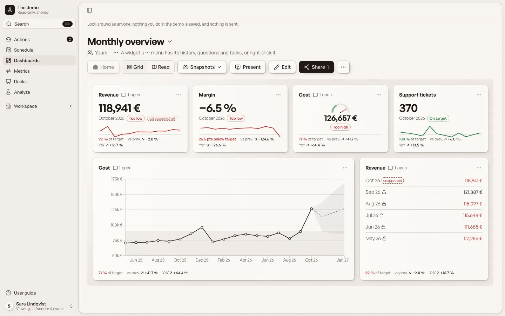
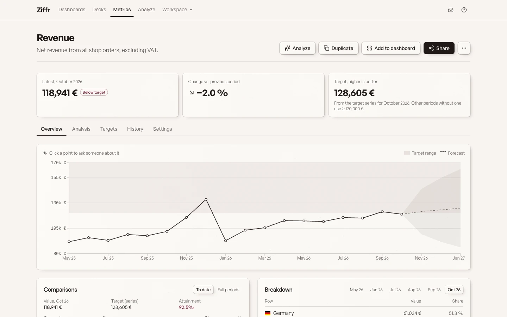
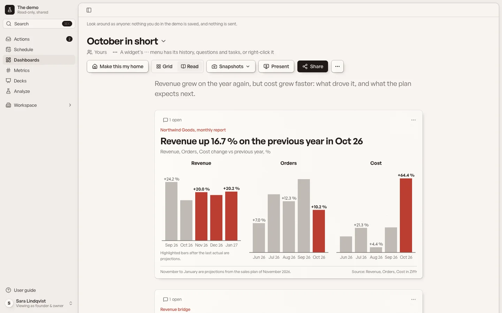

# Ziffr

[](https://github.com/ziffr/ziffr/releases/latest)
[](LICENSE)
[](https://github.com/ziffr/ziffr/labels/good%20first%20issue)

**Ziffr is a metric tracker.** Define any number you care about. Ziffr asks people for its values when they are due, or people and systems send them in on their own. Then see, share and discuss them over time. For one person, a team or a business.

What that includes: values captured where people already work (a form link, email, Slack, Telegram, an API, an AI assistant), dashboards, decks and comparisons, and Workflows that ask for each number, remind, check unusual values and lock a period when it is done. Everyone sees what was shared with them, nothing more.

Ziffr is in its `0.x` releases: used and tested, but names and settings may still change between versions. See the [releases](https://github.com/ziffr/ziffr/releases) for what each version brought, and the [Preview](https://github.com/ziffr/ziffr/releases/tag/preview) for what is coming in the next one.



## What it does

- **Metrics and values.** Define Metrics from scratch or from the Metric Catalog, with targets, Polarity and a Submission Rule. Values come in through each Submitter's personal form link, by email replies, by replying in [Telegram](docs/guides/telegram.md) or Slack, through the [API](docs/guides/api.md), from another system such as a CRM or a data warehouse through a [Feed](docs/guides/feeds.md), or from an AI assistant, such as Claude.ai, through the [MCP server](docs/guides/mcp.md). Contacts without an account submit too.
- **Workflows.** Ask Submitters when a period closes, remind before the Due Date, escalate after it, have Unusual Values approved, and lock the period. They run on their own each morning in the workspace's time zone ([scheduled jobs](docs/guides/jobs.md)).
- **Asking without leaving.** Questions and tasks on a value, answered in a Thread or by replying to the email, with Corrections the Metric owner accepts.
- **Seeing the numbers.** Drag-and-drop dashboards of Widgets and Findings, read as a grid or top to bottom, an Analysis Canvas (forecast, correlation, drivers), comparisons against earlier periods and targets, and decks exported to PowerPoint or PDF.
- **Your own Views and Analyses, without code.** [View Designs](docs/guides/view-designs.md) and [Analysis Recipes](docs/guides/analysis-recipes.md) are plain files Ziffr checks and draws with its own renderer and verified functions. Every built-in View for Metrics and Analyses is one, so you can export it, change it in the Playground and bring it back.
- **Teams.** Workspaces with Owners, Admins, Members and Guests; sharing with people and Groups; invitations by email or link; handover when someone leaves; View Links for people outside.
- **For programs.** A versioned REST API with Access Keys, limits and an Access Log, a TypeScript SDK ([`@ziffr/sdk`](https://www.npmjs.com/package/@ziffr/sdk)) and a local MCP server ([`@ziffr/mcp`](https://www.npmjs.com/package/@ziffr/mcp)). Feeds send values from your own systems with [`@ziffr/feed-kit`](https://www.npmjs.com/package/@ziffr/feed-kit) and [`@ziffr/feed-sql`](https://www.npmjs.com/package/@ziffr/feed-sql).

| | |
| --- | --- |
|  |  |
| **A Metric** with its target range, history and forecast | **A Workflow** that asks for each value, reminds, checks and has it approved |
|  |  |
| **The Read view** of a dashboard, to explain what happened | **The Analysis Canvas**: forecast, correlation and drivers |

The screenshots show the demo's made-up online shop.

## Try it

**The demo.** Try it at **[demo.ziffr.net](https://demo.ziffr.net)**, nothing to install; everyone shares it, and it starts fresh every night. "Try the demo" opens a made-up 15-person online shop, without an account. Its data is generated relative to today, so last month's cost spike stays last month. Switch between its people with "View as" and reset it with ↺ in the header. The guided tour (bottom right) walks through defining a Metric, capturing a value, building a dashboard, asking a question, analysing, and making a deck.

**Locally.** Needs Node 22, pnpm 10 (`corepack enable` sets up the version this repository names), Docker, and the [Supabase CLI](https://supabase.com/docs/guides/local-development/cli/getting-started) (`brew install supabase/tap/supabase` on macOS; CI uses 2.116).

```sh
pnpm install
cp .env.example .env.local   # then fill in SUPABASE_SERVICE_ROLE_KEY from `supabase status -o env`
pnpm prototype               # local Supabase (ports 554xx) and the app on http://localhost:3000
pnpm prototype:reset         # wipe the local database and re-seed the demo
pnpm prototype:stop          # stop local Supabase
```

Local Supabase also runs Mailpit at http://127.0.0.1:55424, where every email Ziffr sends lands when `ZIFFR_SMTP_URL=smtp://127.0.0.1:55425`.

**The user guide.** [docs/user-guide](docs/user-guide/01-what-ziffr-is.md) explains Ziffr without technical words: what it is, its ideas, how it is built and connected, templates, getting started, and a glossary taken from GLOSSARY.md. The app shows it at `/guide`.

**On your own servers.** Ziffr is source-available, and you can run it yourself with Docker:

```sh
curl -fsSL https://github.com/ziffr/ziffr/releases/latest/download/compose.yml -o compose.yml
docker compose up -d                       # http://localhost; set ZIFFR_DOMAIN in .env for https on your domain
```

[docker/README.md](docker/README.md) has the settings, upgrades and backups. [Running Ziffr yourself](docs/guides/self-hosting.md) also covers running it against your own Supabase project, with a checklist for production.

## Not there yet

- WhatsApp and ticket systems are simulated Connectors: the Connectors and Sources pages let you play the other side. Email and Slack are real.
- Analyses, Views and Sources are built in; the seams for plugging in others are marked in `apps/web/src/analyses`, `views` and `sources`.
- Clustering and impact analysis are shown as "coming soon".
- The slide editor uses tldraw, which needs a license from tldraw for production use.

## Working on Ziffr

[CONTRIBUTING.md](CONTRIBUTING.md) and [AGENTS.md](AGENTS.md) are the standards; [GLOSSARY.md](GLOSSARY.md) is the vocabulary. Bigger changes start as a spec in [docs/specs](docs/specs/README.md); hard-to-reverse decisions are in [docs/adr](docs/adr). How Ziffr is secured: [docs/security/threat-model.md](docs/security/threat-model.md).

```sh
pnpm typecheck && pnpm lint && pnpm test   # what CI runs on every pull request
pnpm --filter @ziffr/core test:db          # the core against the local database
```

## License

Ziffr is **source-available** under the [Business Source License 1.1](LICENSE): use it, change it and run it yourself, also commercially inside your organisation; offering it to others as a hosted or managed service is reserved. Consultants may set it up and support it for a client, but not run it for them ([ADR 0009](docs/adr/0009-no-managed-service-by-others.md)). Each version becomes AGPL-3.0 three years after release. The SDK, the MCP server, the feed kit and the SQL Feed are MIT, and the connector kit will be. Why: [ADR 0002](docs/adr/0002-source-available-license.md).
