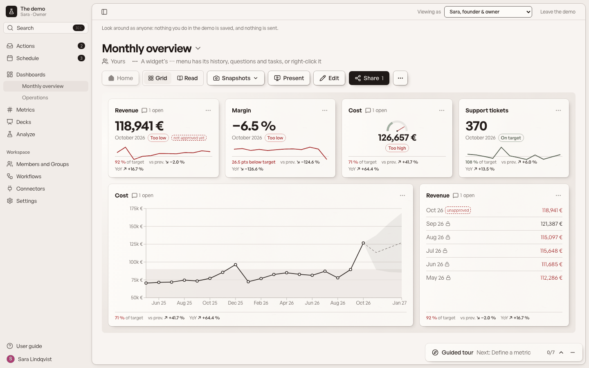

# Usability review, November 2026

**Ticket:** #504. **Reviewed:** the sidebar preview of #502 / PR #503 (branch `feat/ui-layout-preview`, commit `3290bfad`), production build, 21 November 2026. **Screenshots:** [`2026-11-ux-review/`](2026-11-ux-review/), named by number below.

## The five things that matter most

1. **You cannot type a value on a Metric's page.** After creating a Metric, the page offers eight buttons, Share in black, but nothing to record this month's number. The form is three levels down: Settings tab, *Who submits*, *Open form link*. Recording a value is the one thing every Workspace does first. (Walk-through 1, screenshot 06, #521)
2. **Search finds four kinds of things, not "anything".** ⌘K finds Metrics, a value for a period, dashboards and decks. "invite", "webhook", "settings", "approval", a person and a Workflow all give *Nothing found*. The spec makes ⌘K the main way to find anything; today it cannot be. (Walk-through 8, screenshot 14, #530)
3. **The Workspace group is an admin panel, shown twice, and your own Schedule is filed under settings.** Owners see 13 rows, daily and yearly pages mixed. On `/settings/*` pages the same list appears again inside the page; on `/team`, `/connectors`, `/workflows` it does not. My schedule, a person's to-do list, is a settings page and, in the demo, can only be reached through Workspace → General. (Page map, screenshots 01 and 10, #529)
4. **Guests are shown work they are not allowed to do.** A Guest "creates nothing", yet gets New metric, Paste values, New deck, Create dashboard, the Metric Catalog and a tour that says "Next: Define a metric". The empty Dashboards list tells them to "Name one above" with no field above. Every path ends in a refusal. (Screenshots 17, 18, #522)
5. **Some messages say things happened that did not.** "Everyone who submits it got a form link and a first request" appears after creating a Metric that nobody submits, and on an Installation that sends no email. "Invitation made" does not say whether an email went out. A metric tracker lives on trust in what it reports. (Walk-throughs 1 and 5, #523)

What works well: pages load in under a second and switching pages in the sidebar takes 20 to 100 ms; the Details slide-over (21) and the Workflow editor (11) are clear; the catalog with search and categories (04) is a good start; refusals are short and honest; there is a skip link, a visible focus ring, no sideways scrolling at 390 px, and almost all text passes 4.5:1 contrast.

## How this was done

- The preview branch as a production build (`next build`, `next start`) on its own database with the demo seed, at 1440 × 900 and 390 × 844, driven with Playwright.
- **Roles.** The demo has only an Owner (Sara) and Members. To see an Admin and a Guest, I changed two demo people **in my local copy only**: Ben to Admin, Tom to Guest. A Contact has no login; their whole Ziffr is the form link, which I used as a submitter.
- **A real Workspace.** Signed up as a new person on the same build (mail caught locally), created a Workspace and did the tasks the demo refuses: create a Metric, record a value, build and share a dashboard, a Workflow with Approval, invite, Webhook, Retention.
- **Limits.** This Installation has no Slack app, Telegram bot or mail server, so those Connectors are *Simulated* and nothing was sent. I could not finish "connect Telegram/Slack" for real; the walk-through covers everything up to that point. Role refusals for Members on Feeds, Webhooks and Usage were seen only in the demo, where they say "the demo has none".
- Judged against Nielsen's ten heuristics, GLOSSARY.md, WCAG 2.2 AA checks run in the browser (contrast, names, focus) and the Web Interface Guidelines.

## 1. Page map

Grouped the way a person thinks of them. **Reached by:** S = sidebar row, W = Workspace group in the sidebar, U = user menu, L = settings side list (only on `/settings/*` pages), K = ⌘K, P = a link on another page. Roles: O Owner, A Admin, M Member, G Guest, C Contact.

| Group | Page | Route | Shown to | Reached by | Notes |
| --- | --- | --- | --- | --- | --- |
| Your work | Home (your Home dashboard) | `/` | O A M G | S (Dashboards row lights up), logo | First run shows *Get your workspace ready* (03); a Member or Guest with nothing shared sees "No dashboards yet" |
| | Actions | `/actions`, `/actions/[id]` | O A M G | S with count, phone tab | |
| | My schedule | `/settings/schedule` | O A M G | U, L | A person's duties live under settings; **not in the sidebar**; in the demo only via Workspace → General's side list |
| | Submit from the Schedule | `/schedule/submit/[slug]` | submitters | P from My schedule | |
| Numbers | Dashboards list | `/dashboards` | all | S, phone tab | |
| | Dashboard, Present, Snapshot | `/dashboards/[id]`, `…/present`, `…/snapshots/[sid]` | who it is shared with | P, K, title switcher | |
| | Metrics list | `/metrics` | all | S, phone tab | Details slide-over per row (21) |
| | Metric | `/metrics/[slug]` | who sees it | P, K | Tabs Overview, Analysis, Targets, History, **Settings** |
| | Period Record | `/metrics/[slug]/[period]` | who sees it | K ("revenue october 2026"), P | |
| | New metric | `/metrics/new` | all (Guests too) | P (Metrics list), first run | Guests can open it and fill it in (18) |
| | Paste values | `/paste-values` | all (Guests too) | P (Metrics list only) | |
| | Decks, Deck, Present | `/decks`, `/decks/[id]`, `…/present` | all | S | |
| | Themes | `/themes` | all; Owners/Admins change | P from Decks, dashboard ⋯ → Theme… | **Orphan for its job**: an Owner styling dashboards looks in Workspace, not Decks |
| | Analyze | `/analyze` | all | S | |
| | View Designs, Playground | `/analyze/designs`, `/analyze/playground` | all | P from Analyze only | |
| Workspace | General (incl. Size and usage, Retention default) | `/settings/workspace` | all; O A change | W, L | 8 sections, 8 Save buttons (13) |
| | Members and Groups (page titled **Team**) | `/team` | all | W, L | No settings side list on this page (10) |
| | Connectors (+ Who gets what, + Outbox, + AI assistants) | `/connectors` | all | W, L, P | Four pages in one (12, 24) |
| | Workflows | `/workflows` | all | W, L, P | |
| | Sources | `/sources` | all | W, L, P (Metric, Connectors, tour) | Overlaps Connectors and the Metric's submitters |
| | Packs | `/settings/packs` | O A M | W, L | |
| | Access Keys | `/settings/keys` | all | W, L, P (Connectors) | |
| | Feeds | `/settings/feeds` | O A | W, L | Members reach it by URL |
| | Webhooks | `/settings/webhooks` | O A | W, L | Members reach it by URL |
| | Activity | `/activity` | all | W, L | Not a glossary term; Guests see every person's name as a filter |
| | Usage | `/settings/usage` | O A | W, L | |
| | Audit log | `/audit` | O A | W, L | Members get "Only Owners and Admins…" |
| | Make room | `/settings/size/make-room` | O A, only when over the Workspace Limit | P from General, over-limit bar | 404 otherwise |
| You | Your profile | `/settings/profile` (also `/settings`) | all | U, L | Holds the layout switch |
| | Your Deliveries | `/settings/deliveries` | all | U, L, P | Sets Delivery Preferences; the same table for everyone sits on Connectors |
| | Your Alerts | `/settings/alerts` | all | U, L | |
| | Connected assistants | `/settings/assistants` | all | L, P (Connectors) | **Not in the user menu** |
| Installation | Installation settings | `/installation` | Installation Admins | U | |
| Outside the app | Sign in, Start a workspace, Trial, Trial Guide, Invitation, OAuth consent, demo confirm | `/login`, `/welcome`, `/try`, `/try/start`, `/invite/[token]`, `/oauth/authorize`, `/demo/confirm` | anyone | links, email | |
| | Form link | `/submit/[code]` | its submitter, incl. C | email, chat, Metric → Settings → *Open form link* | The whole Ziffr for a Contact (07) |
| | View Link | `/v/[token]` | anyone with it | link | |
| | User guide | `/guide`, `/guide/[chapter]` | all | S (bottom) | |
| Dead | Stories | `/stories` | — | nothing links to it | Redirects to `/dashboards`; can go |

**Duplicates.** The Workspace list twice on `/settings/*` (sidebar and page); the *You* pages in the user menu and the settings list with different names ("Your profile" / "Profile", "Your Deliveries" / "Deliveries"); Delivery Preferences on Connectors and on Your Deliveries; Retention on the Metric's Settings tab and on General (fine: default and override); *Who can see this* and *View links* in both the Share dialog and the dashboard's ⋯ (22) (fine as shortcuts); what came in shown on Sources, the Outbox on Connectors and the Metric's History.

**⌘K today** covers Metrics, a Metric's value for a period, dashboards and decks. Nothing else.

**Sidebar rows by role** (preview): Owner and Admin 5 + 13 Workspace rows; Member 5 + 9 (no Feeds, Webhooks, Usage, Audit log); Guest 5 + 8 (no Packs either). Every role reaches every URL; the page itself refuses.

## 2. Task walk-throughs

Clicks count from the page where a person would start. *Hesitation* marks where I would expect someone to stop and look around.

### 1. Define a Metric and record a value (Owner, new Workspace)

1. Metrics → **New metric** → pick *Customer satisfaction* in the catalog (04) → the form opens filled in (05).
2. *Who submits* starts empty. Tick yourself → **Create metric**. 4 clicks so far. Good: the catalog, its search and the copy "It's your metric now" are clear.
3. The page says "Metric created. … Everyone who submits it got a form link and a first request for the value." (06) Nothing was sent: this Installation has no mail server, and the request sits in the Outbox as *Simulated*. **Hesitation:** where do I type the value? The buttons are Ask me now, Alert me…, Analyze, Duplicate, Add to dashboard (greyed), Archive…, Delete…, **Share** (black). *Ask me now* sends me a Prompt.
4. Found it: **Settings** tab → scroll to *Who submits* → **Open form link**. 7 clicks in total.
5. Typed "abc" by mistake: "Couldn't find a number in the **message**." above the field, and my text is gone (07). Typed 88 → "88 % recorded…".

Words: the field is labelled **Total** for a single percentage; the page footer says "This link is owner's **Token**"; the second-value option says "Good for **snapshots**"; the Metric's description lives under a tab called **Settings**. Creating the same catalog Metric twice gave two "Customer satisfaction" with no warning (08).

### 2. Build a dashboard (Owner)

Dashboards → type a name → **New dashboard** → it opens in edit mode with the Pool (08) → **+** on a Metric → **Done**. 4 clicks. Quick.

Hesitation: the two Metrics of the same name look identical in the Pool. The name appears twice, as the title and in a field below it. Two black buttons sit side by side (Done, Share). The hint "A widget's ⋯ menu has its history…" shows on an empty dashboard. Every Pool button is called "Add" for a screen reader.

### 3. Set up a Workflow with an Approval (Owner)

Workspace → Workflows → **New workflow** (saves one called "New workflow" at once) → rename → **Add approver** → **Save workflow** (11). 6 clicks. The steps read like the glossary: Ask, Remind, Escalate, Check, Approve, Publish.

**Dead end:** "No metrics yet. A metric's owner picks its workflow on the metric's page." To put ten Metrics on it: open each Metric → Settings tab → Workflow. About 30 clicks across 20 pages. Also on this page: "Whoever runs Ziffr for this workspace still has to turn on the hourly schedule; until then, run today's steps by hand", which is operator language on an Owner's page.

### 4. Connect Telegram or Slack (Owner, then for yourself)

Workspace → Connectors. The whole first screen is *Claude and other AI assistants* with a shell command and a JSON block (12). Slack and Telegram start below the fold. On this Installation they say "Simulated. This Ziffr has no Slack app… Whoever runs it can set one up on its Installation settings page." There is no link, and on a self-hosted Ziffr the Owner usually is that person. Further down: the *Who gets what* table for every person, then the Outbox (24). Linking my own Telegram would happen under Your Deliveries; not testable without a bot.

### 5. Invite someone (Owner)

Workspace → **Members and Groups** → the page is titled **Team** (10) → address, role → **Invite**. 3 clicks. Toast "Invitation made" and "Send this link: …". Without a mail server nothing was emailed, but the toast does not say so. The *Invite by email* label sits on a different baseline than its field; the Away and Groups areas have no headings.

From a dashboard's Share dialog there is no way to invite; alone in a Workspace it offers only "Everyone in the workspace" (09).

### 6. Set up a Webhook (Owner)

Workspace → Webhooks → address, events → **Add Webhook**. 3 clicks. The copy is honest about TLS and Workspace Keys; it is two paragraphs before the form, which is acceptable for a page Owners open once. Members do not see it in the sidebar.

### 7. Change Size and Retention (Owner)

Workspace → General: "Size and usage: 2 Metrics, without a limit." A self-hosted Workspace has no Size, as the glossary says, and the page does not pretend otherwise. Retention for new Metrics is the 8th section of the same page (13), below Attainment; each section has its own Save (8 on the page). Per Metric: Metric → Settings tab → Retention. Time zone is a list of about 400 entries without search. Usage is a separate row and suggests Retention there (23).

### 8. Find something with ⌘K (Owner, demo)

"rev" → Revenue. "revenue october 2026" → the value, then the Metric. Both instant and right. "invite", "webhook", "settings", "approval", "ben", "monthly finance" (a Workflow) → "Nothing found. Try a Metric's name…" (14). Opened empty, it shows only an example.

### 9. Answer an Action (Ben as Admin, demo)

Sidebar **Actions 1** → the item → **Approve**. 2 clicks; the sidebar badge works. On the page (15): the text says "Reply "approve", or "send back:" with what to check", which are chat instructions next to the buttons that do it. "To correct it, propose a correction below" points at a reply box with no value field. The Approval box has a red frame, the same red as "Too low". In the demo the refusal reads "Not done. The demo can't be changed." with no trial link (16).

### 10. Share a dashboard (Owner)

**Share** → set *Everyone in the workspace* to Viewer. 2 clicks. With nobody else in the Workspace there is nobody to pick and no invite (09). *View links for outsiders* is one click further.

### The same Ziffr as a Guest, a Member and a Contact

- **Guest (Tom):** sees New metric, Paste values, Create dashboard, New deck and the catalog (18), the tour's "Next: Define a metric", and "Name one above" on an empty list with no field (17). The Workspace group shows Members and Groups, Connectors, Workflows, Sources, Access Keys and Activity; Activity lists every person as a filter.
- **Member (Anna):** lands on "No dashboards yet. Create one, or ask a colleague…". Clear. Opening Feeds or Webhooks by URL in the demo says "The demo has no Feeds", which hides that a Member could not use them anyway.
- **Contact:** the form link is all they see (07): their name, the Metric, the period, one field. Good, apart from "Token", "Total" and the error wording.
- **The demo itself:** *Viewing as* lists job titles ("Ben, operations lead"), not roles, and the seed has no Admin or Guest. It has no user menu, so a visitor finds My schedule only through Workspace → General.

## 3. Heuristic review

Severity: 0 not a problem, 1 cosmetic, 2 minor, 3 major, 4 blocks the task. Frequency: how many people meet it how often.

| # | Finding | Heuristic | Sev. | Freq. | Evidence | Ticket |
| --- | --- | --- | --- | --- | --- | --- |
| H1 | No way to record a value from a Metric's page; the form link hides in its Settings tab | Recognition over recall; flexibility | 3 | High | 06, WT 1 | #521 |
| H2 | ⌘K finds only Metrics, values, dashboards, decks; no pages, commands, Workflows, Actions, recents | Recognition; flexibility | 3 | High | 14, WT 8 | #530 |
| H3 | Workspace group of 13 rows; the same list again in `/settings/*` pages and missing on six others; Schedule under settings; Themes under Decks | Consistency; minimalist design | 3 | High | 01, 10 | #529 |
| H4 | Guests see create buttons, catalog, tour step and "Name one above" that all end in refusals | Error prevention; match with the real world | 3 | Medium | 17, 18 | #522 |
| H5 | "Everyone who submits it got a form link and a first request" is shown when nobody submits or no mail goes out; "Invitation made" is silent about email | Visibility of system status | 3 | Medium | 06, 10 | #523 |
| H6 | A Workflow's Metrics can only be set from each Metric | Flexibility and efficiency | 3 | Medium | 11, WT 3 | #531 |
| H7 | Words: page **Team** vs nav **Members and Groups** (Team is _Avoid_ for Group); Metric tab **Settings** (_Avoid_ for Metric Description); "Good for **snapshots**"; **Token** and **Total** on the form; "Your/My/–" naming differs between menu, list and page titles; "Your Deliveries" sets Delivery Preferences | Consistency and standards | 2 | High | 05, 07, 10 | #524 |
| H8 | Same-named Metrics allowed silently and indistinguishable in Pool, lists and ⌘K (also in the demo: two "Support tickets") | Error prevention | 2 | Medium | 08 | #533 |
| H9 | Form link error speaks of a "message", empties the field, sits above it without a link to it | Help users recover from errors | 2 | Medium | 07 | #525 |
| H10 | Approval in the web shows chat commands; "correction below" has no value field; red frame for a normal step | Match; aesthetic | 2 | Medium | 15 | #527 |
| H11 | Connectors page holds AI setup, Connectors, a table for every person and the Outbox; simulated cards point to Installation settings without a link | Minimalist design; help | 2 | Medium | 12, 24 | #532 |
| H12 | Metric toolbar: eight equal buttons, Archive… and Delete… beside Share, while *Who can see this* and *Versions* hide in ⋯ | Minimalist design; error prevention | 2 | High | 06 | #521 (with the new button) |
| H13 | Phone: demo bar, title, hint and seven buttons in three rows before the first number; tour pill over content; More sheet repeats tabs and lists 13 rows; sideways settings list without a cue | Aesthetic; flexibility | 2 | Medium | 19 | #535 |
| H14 | Same accessible name on many buttons ("Add" ×16, "Remove…" ×6, "Earlier/Later/Remove step", two "More" on a phone dashboard); ⌘K hint 2.5:1; chips 10 to 11 px | Accessibility (WCAG 2.4.6, 1.4.3) | 2 | High for screen-reader users | 20 | #526 |
| H15 | Share dialog offers no person and no invite in a small Workspace | Flexibility; user control | 2 | Medium (new Workspaces) | 09 | #534 |
| H16 | Demo: roles not shown, no Admin or Guest, no user menu, refusal without the trial link, tour starts with a refused step | Match; help | 2 | High for visitors | 16 | #528 |
| H17 | General page: 8 sections with 8 Save buttons; 400-entry time-zone list without search | Consistency; efficiency | 1 | Low | 13 | not filed |
| H18 | **New workflow** saves a Workflow called "New workflow" immediately; empty Workflows page has no explanation or templates | User control | 1 | Low | WT 3 | not filed |
| H19 | `/stories` is a dead route; Playground and View Designs reachable only from Analyze | Navigation | 1 | Low | page map | in #529 |
| H20 | The Approval and form errors use the coral ring colour for focus and for "bad", so focus can read as an error | Accessibility | 1 | High | 20 | not filed |

**Empty states** are mostly good: they say what to do next ("Describe your first one, or ask a colleague to share theirs"). The exceptions are the Guest ones (H4) and the Workflows page, which has only a faint *New workflow* link.

**Refusals** are short and say why ("Only Owners and Admins of this workspace see the Audit Log."). In the demo, "The demo has no …" hides a role refusal, and "The demo can't be changed" lacks the way out.

**Performance feel.** Production build on this machine: full loads 600 to 950 ms to network idle, LCP under 410 ms, sidebar switches 20 to 100 ms. The catalog shows "Loading metrics" for about a second. Nothing here feels slow.

## 4. Proposed information architecture

Principle: the sidebar holds **places a person goes every week**, in the order of their week: what is waiting for me, the numbers, then the Workspace. Pages people open once a quarter go one level down, into Settings, and stay one keystroke away through ⌘K.

```
[Northwind Goods ▾]        switcher; subtitle shows your role: "Sara · Owner"
[Search…            ⌘K]
Actions            2       questions and tasks waiting for you
Schedule           3       values due from you (moves up from settings)

Dashboards
  Monthly overview         pinned dashboards (#509)
  Operations
Metrics
Decks
Analyze

Workspace                  closed unless you are in it
  Members and Groups
  Workflows
  Connectors               Sources joins it as "Values in"
  Settings                 one page, its own grouped list:
     Workspace   General · Size and Retention · Themes · Packs
     Programs    Access Keys · Feeds* · Webhooks*
     Records     Activity · Usage* · Audit log*
                                                  * Owners and Admins

User guide
[Sara Lindqvist ▾]         Your profile · Deliveries · Alerts · Connected assistants
                           · Installation settings (Installation Admins) · Sign out
```



**Why this order.**

- **Actions and Schedule first.** They are the only rows with a number that asks you to act. A submitter's whole job is the Schedule; filing it under settings (today) makes the most common person hunt.
- **Dashboards before Metrics.** People come to look; Metrics is where they define and check. Decks and Analyze are for fewer people, less often.
- **Workspace keeps four rows.** Members and Groups, Workflows and Connectors are what Owners and Admins change month to month. Everything else is set once; thirteen rows of it make every Owner's sidebar read like an admin console (spec question 2: this is a middle way between its two options).
- **One Settings page with its own list** removes the double list: the sidebar says *Settings*, the page lists its parts. Pages that are not settings (Members and Groups, Workflows, Connectors) never show the list, so the frame is the same wherever you are.
- **Themes move to Settings.** They are a Workspace decision made by its Owners, not a Decks feature.
- **The role in the switcher** answers "what may I do here?" before a refusal does.

**By role.** Owner and Admin: as drawn. Member: the same four Workspace rows; Settings lists General (read only), Themes, Packs, Access Keys, Activity. Guest: Actions, Schedule, Dashboards, Metrics, Decks; no Analyze (it saves widgets) and no Workspace group, unless the owner decides Guests should see Members and Groups (question 1 below). Contact: no sidebar; the form link only.

**Slide-overs** (beyond #510's Alert me…, Share, Version history and quick look): **Record a value** (from the Metric page, its Details panel and the Schedule), an **Action's thread** opened from the Actions list, **Invite someone** from the Share dialog, and a **Period Record** quick look from a widget. Creating a Metric, a Workflow or a dashboard stays a page.

**⌘K should cover** (#530): today's Metrics, values, dashboards and decks; every page in the tree above by name and a few plain words ("invite", "retention", "webhook"); commands (New metric, New dashboard, New deck, Paste values, Invite someone, Record a value for …); Workflows; open Actions; recent items when empty. Only what the person may see and do.

**Phone tabs.** Keep the spec's five: **Dashboards, Metrics, Actions, Search, More**, with Actions' badge counting due values too. The More sheet should hold what the tabs do not: Schedule, Decks, Analyze, Workspace (one row to a list), your own pages, the Workspace switcher, User guide, Sign out. Today it repeats Dashboards and Metrics and lists all 13 Workspace pages (19).

## 5. Recommendations, in order

### Quick wins (a day or less each)

| Change | Evidence | Ticket |
| --- | --- | --- |
| **Record a value** button on a Metric's page for its submitters; Archive… and Delete… into ⋯ | WT 1, 06 | #521 |
| Hide what Guests cannot do; fix their empty states | 17, 18 | #522 |
| Messages that match the Outbox after creating a Metric or inviting | WT 1, WT 5 | #523 |
| Words: Team, Settings tab, snapshots, Token, Total, Your/My | H7 | #524 |
| Form link: keep the input, error at the field, form wording | 07 | #525 |
| Accessible names for repeated buttons, ⌘K hint contrast, chip size | H14, 20 | #526 |
| Approval in the web: no chat commands, *Correct the value*, neutral frame | 15 | #527 |
| Demo: roles in *Viewing as*, an Admin and a Guest, the user menu, the trial link | 16 | #528 |

### Bigger changes (decide with #511, before the sidebar becomes the default)

| Change | Evidence | Ticket |
| --- | --- | --- |
| The sidebar tree above: Schedule up, four Workspace rows, one Settings page with a grouped list, Themes into Settings, Sources into Connectors | 01, 02, page map | #529 |
| ⌘K for pages, commands, Workflows, Actions, recents | 14 | #530 |
| Add Metrics to a Workflow from the Workflow page | 11 | #531 |
| Connectors page: Connectors first; AI setup and Outbox apart | 12, 24 | #532 |
| Warn about duplicate Metric names; tell them apart in pickers | 08 | #533 |
| Share dialog: pick a person or invite | 09 | #534 |
| Phone: one toolbar row, a shorter More sheet, a smaller demo bar | 19 | #535 |

Related tickets already open: #509 pinned dashboards (agree, and it belongs under Dashboards as drawn), #510 slide-overs (add Record a value), #511 sidebar as default (do #529 first, so the default is not changed twice).

## Questions for the owner

1. **What may a Guest see of the Workspace?** Today a Guest's sidebar shows Members and Groups, Connectors, Workflows, Sources, Access Keys and Activity, and Activity lists every member as a filter. The glossary says a Guest "only sees what is shared with them". Recommendation: no Workspace group for Guests; ask for a security review of what those pages show them.
2. **Who changes Themes?** The Themes page says "Only owners and admins of the workspace change themes"; the glossary says "Only the workspace owner changes themes". One of them is wrong.
3. **"Activity"** is not a glossary term. It lists Versions and Superseded Values across the Workspace. Keep the name and add it to the glossary, or call it "Changes"? Recommendation: "Changes", added to the glossary.
4. **Schedule as its own sidebar row** (recommended), or Actions and Schedule merged into one "Waiting for you" page? The glossary keeps them apart, so two rows.

## Screenshots

| # | What it shows |
| --- | --- |
| 01 | Owner on General: the Workspace list in the sidebar and again in the page |
| 02 | The proposed sidebar (DOM rearranged in the browser, no code changed) |
| 03 | First run for a new Owner |
| 04 | New metric: the catalog |
| 05 | The Metric form from the catalog |
| 06 | Metric just created: eight buttons, none to record a value; the banner's claim |
| 07 | Form link after typing a non-number: error above, input emptied, "Token", "Total" |
| 08 | Dashboard in edit mode: two identical "Customer satisfaction" in the Pool |
| 09 | Share dialog in a one-person Workspace |
| 10 | Members and Groups, titled "Team", after an invitation without email |
| 11 | Workflow editor: steps, and "A metric's owner picks its workflow on the metric's page" |
| 12 | Connectors: the first screen is the AI assistant setup |
| 13 | General: Answer languages, Attainment, Retention, each with its own Save |
| 14 | ⌘K: "invite" finds nothing |
| 15 | An Approval in the web with chat instructions and a red frame |
| 16 | Demo refusal without the trial link |
| 17 | Guest: "Name one above" with no field |
| 18 | Guest: the Metric Catalog and Start from scratch |
| 19 | Phone: dashboard, More sheet, Members and Groups, General |
| 20 | Keyboard focus in the sidebar; the Metrics list |
| 21 | The Details slide-over on the Metrics list |
| 22 | A dashboard's ⋯ menu |
| 23 | Usage in a new Workspace |
| 24 | Connectors, the whole page |
